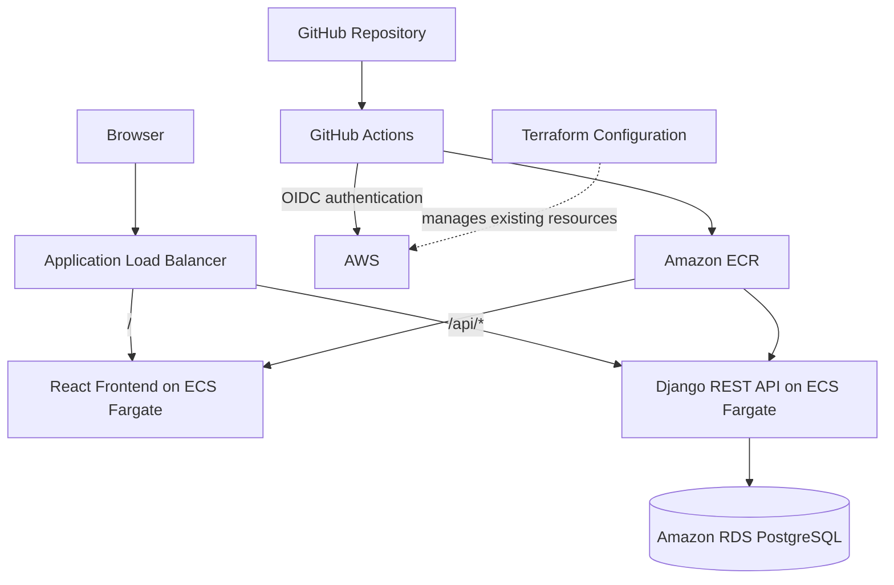

# CloudForge — Cloud-Native Deployment Project

CloudForge is a full-stack application deployed on AWS using Docker, Amazon ECS with AWS Fargate, Amazon ECR, an Application Load Balancer, Amazon RDS for PostgreSQL, Terraform, and GitHub Actions.

The project demonstrates containerization, cloud infrastructure management, CI/CD automation, application routing, health checks, and deployment troubleshooting.

## Live Application

- **Frontend:** http://cloudforge-alb-174669174.ap-south-2.elb.amazonaws.com/
- **API endpoint:** http://cloudforge-alb-174669174.ap-south-2.elb.amazonaws.com/api/notes/
- **AWS Region:** `ap-south-2` (Asia Pacific — Hyderabad)

The application and API returned HTTP 200 after the latest successful deployment. The live endpoints use HTTP, not HTTPS.

## Architecture



### Request flow

1. A browser requests the application through the Application Load Balancer.
2. The ALB forwards `/` requests to the frontend target group.
3. Requests under `/api/*` are routed to the Django backend target group.
4. The backend uses PostgreSQL for application data.
5. GitHub Actions builds container images, pushes them to ECR, and triggers ECS deployments.
6. Terraform configuration describes the AWS resources managed by the project.

## Technology Stack

| Area | Technologies |
|---|---|
| Frontend | React, Node.js |
| Backend | Python, Django, Django REST Framework, Gunicorn |
| Database | PostgreSQL 16 locally; Amazon RDS PostgreSQL in AWS |
| Containers | Docker, Docker Compose |
| AWS compute | Amazon ECS, AWS Fargate |
| Image registry | Amazon ECR |
| Networking | VPC, subnets, security groups, Application Load Balancer |
| Infrastructure as Code | Terraform |
| CI/CD | GitHub Actions, AWS IAM OIDC |
| Region | `ap-south-2` |

## Repository Structure

```text
.
├── .github/
│   └── workflows/
│       └── ci.yml
├── app/
│   ├── backend/
│   │   ├── core/
│   │   ├── notes/
│   │   ├── requirements/
│   │   └── Dockerfile
│   └── frontend/
│       └── notes-frontend/
│           ├── Dockerfile
│           └── package.json
├── terraform/
│   ├── main.tf
│   └── .gitignore
├── .env.example
├── .gitignore
└── docker-compose.yml
```

## Application Features

- React frontend served from a container.
- Django REST API for notes.
- PostgreSQL database configuration for local and cloud environments.
- Separate frontend and backend ECS services.
- ALB path-based routing.
- Dedicated backend health endpoint at `/healthz/`.
- Container image publishing to Amazon ECR.
- Automated ECS deployment through GitHub Actions.
- Terraform configuration for existing AWS infrastructure.

## Run Locally

### Prerequisites

Install Docker Desktop with the Docker Compose plugin and Git.

### 1. Clone the repository

```bash
git clone https://github.com/Vishalkumar0509/cloudforge.git
cd cloudforge
```

### 2. Configure local environment variables

```bash
cp .env.example .env
```

Edit `.env` and set local PostgreSQL values. Replace the example password with a local development password.

The `.env` file is ignored by Git and must not contain production credentials.

### 3. Build and start the application

```bash
docker compose up --build -d
```

Check container status:

```bash
docker compose ps
```

### 4. Test the application

- Frontend: http://localhost:3000/
- Notes API: http://localhost:8000/api/notes/
- Backend health endpoint: http://localhost:8000/healthz/

Check logs if a service fails:

```bash
docker compose logs --tail=100
```

If database migrations are required, run:

```bash
docker compose exec backend python manage.py migrate
```

### 5. Stop the application

```bash
docker compose down
```

The PostgreSQL data volume is retained when using the normal `docker compose down` command. Do not use `-v` unless you intentionally want to remove the local database volume.

## CI/CD Pipeline

Workflow file: `.github/workflows/ci.yml`

The pipeline runs on pushes and pull requests targeting `main`.

### Pipeline stages

1. **Backend checks:** installs Python dependencies and runs `python manage.py check`.
2. **Frontend build:** installs Node.js dependencies with `npm ci` and runs `npm run build`.
3. **Build and publish:** builds backend and frontend Docker images and pushes them to Amazon ECR.
4. **AWS authentication:** assumes an IAM role through GitHub Actions OpenID Connect (OIDC).
5. **Backend deployment:** triggers a new ECS deployment and waits for the backend service to stabilize.
6. **Frontend deployment:** triggers a new ECS deployment and waits for the frontend service to stabilize.

Images are tagged with `latest` and the source commit SHA.

### Deployment verification

List recent workflow runs:

```bash
gh run list --branch main --limit 5
```

Watch a specific run:

```bash
gh run watch RUN_ID --exit-status
```

Check ECS services:

```bash
aws ecs describe-services \
  --cluster cloudforge-cluster \
  --services cloudforge-backend cloudforge-frontend \
  --region ap-south-2 \
  --query 'services[*].{Name:serviceName,Desired:desiredCount,Running:runningCount,Pending:pendingCount}' \
  --output table
```

Verify the public endpoints:

```bash
curl -sS -o /dev/null -w 'Frontend HTTP: %{http_code}\n' \
  http://cloudforge-alb-174669174.ap-south-2.elb.amazonaws.com/

curl -sS -w '\nHTTP: %{http_code}\n' \
  http://cloudforge-alb-174669174.ap-south-2.elb.amazonaws.com/api/notes/
```

## Terraform and Infrastructure Management

The `terraform/main.tf` file describes existing AWS resources, including:

- VPC and three subnets
- Four security groups
- Amazon RDS PostgreSQL instance
- Application Load Balancer
- Frontend and backend target groups
- HTTP listener and API routing rule
- ECS cluster and two ECS services
- Two ECR repositories

The existing infrastructure was imported into Terraform state rather than recreated. The configuration includes a dedicated backend health check and an ECS deployment circuit breaker with rollback enabled.

### Validate the configuration

From the repository root:

```bash
cd terraform
terraform init
terraform validate
terraform plan
```

**Important:** Terraform state is not stored in this repository. A fresh clone does not automatically contain the existing infrastructure state. Restore the authorized state securely or import the existing resources into a correctly configured state before relying on a plan. Do not apply an unreviewed plan against existing infrastructure.

Never commit Terraform state, credentials, production `.tfvars` files, or secret values.

## Health Checks and Troubleshooting

### Backend health endpoint

The ALB checks `/healthz/` and expects HTTP 200. This separates infrastructure health checks from the notes API.

### ECS deployment failures

1. Inspect the GitHub Actions run and identify the failing step.
2. Check ECS service events and deployment status.
3. Verify the backend target group health.
4. Inspect CloudWatch container logs.
5. Confirm that the task can reach its required dependencies.

The ECS deployment circuit breaker is configured to roll back failed deployments.

### Useful commands

```bash
# ECS service events
aws ecs describe-services \
  --cluster cloudforge-cluster \
  --services cloudforge-backend \
  --region ap-south-2 \
  --query 'services[0].events[:10]' \
  --output table

# Backend target health
aws elbv2 describe-target-health \
  --target-group-arn arn:aws:elasticloadbalancing:ap-south-2:024265812756:targetgroup/cloudforge-backend-tg/a9d5c76a69e6bcf1 \
  --region ap-south-2
```

## Security Notes

- GitHub Actions uses OIDC to obtain AWS credentials without storing long-lived AWS access keys in the workflow.
- The IAM role should follow least-privilege permissions.
- Local `.env` files and Terraform state must remain untracked and protected.
- Production Django settings should keep debug mode disabled and restrict allowed hosts and CORS origins.
- The current public endpoints use HTTP. HTTPS and an associated certificate/domain are not documented as implemented.
- Do not expose database credentials, Django secret keys, or other secrets in source code, workflow logs, screenshots, or documentation.

## Current Scope and Limitations

This repository documents the deployed React + Django + PostgreSQL application and its AWS container deployment.

Kubernetes/EKS, Helm, and Argo CD/GitOps are not represented as completed features in this README. Add them only after implementation and verification.

The project uses a small deployment footprint for learning and demonstration. AWS resources may incur charges; review AWS Billing before leaving resources running.

## Author

**Vishal Kumar Anumasa**

- GitHub: https://github.com/Vishalkumar0509
- Project repository: https://github.com/Vishalkumar0509/cloudforge
