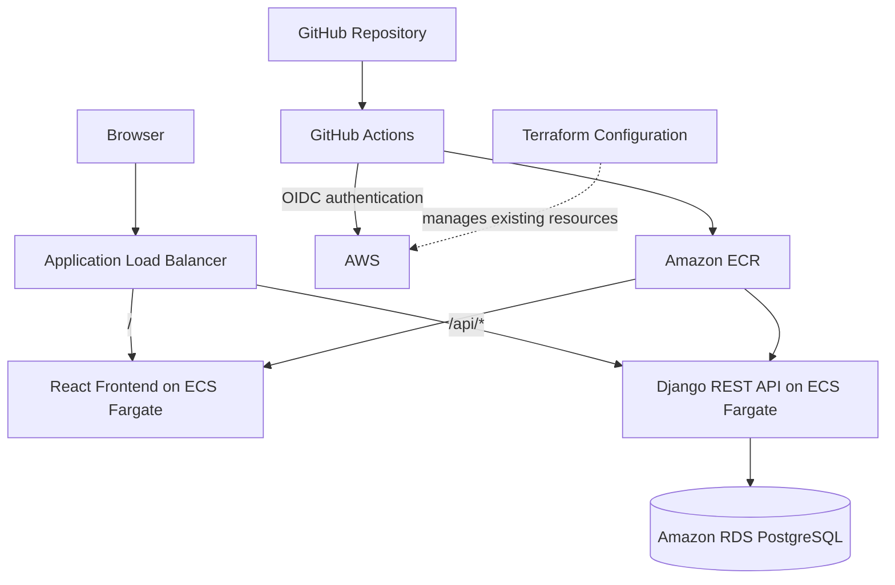

# CloudForge — Cloud-Native Deployment Project

CloudForge is a full-stack application with a verified local Kubernetes deployment and a previously verified AWS deployment using Docker, Amazon ECS with AWS Fargate, Amazon ECR, an Application Load Balancer, Amazon RDS for PostgreSQL, Terraform, and GitHub Actions.

The project demonstrates containerization, cloud infrastructure management, CI/CD automation, application routing, health checks, and deployment troubleshooting.

## AWS Deployment Status

CloudForge was previously deployed to AWS in the `ap-south-2` region
using ECS Fargate, ECR, an Application Load Balancer, and RDS PostgreSQL.
The AWS deployment has since been taken offline for cost control:
the load balancer was deleted, ECS services were scaled to zero, and
the RDS instance was stopped. The former public application URL is no
longer a reliable live endpoint.

The project now also includes a verified **local Kubernetes deployment**
using Docker Desktop Kubernetes. See [Local Kubernetes](#local-kubernetes)
for access instructions and verification details.

## Architecture



### Request flow

1. A browser requests the application through the Application Load Balancer.
2. The ALB forwards `/` requests to the frontend target group.
3. Requests under `/api/*` are routed to the Django backend target group.
4. The backend uses PostgreSQL for application data.
5. GitHub Actions builds container images, pushes them to ECR, and triggers ECS deployments.
6. Terraform configuration describes the AWS resources managed by the project.

## Technology Stack

| Area | Technologies |
|---|---|
| Frontend | React, Node.js |
| Backend | Python, Django, Django REST Framework, Gunicorn |
| Database | PostgreSQL 16 locally; Amazon RDS PostgreSQL in AWS |
| Containers | Docker, Docker Compose |
| AWS compute | Amazon ECS, AWS Fargate |
| Image registry | Amazon ECR |
| Networking | VPC, subnets, security groups, Application Load Balancer |
| Infrastructure as Code | Terraform |
| CI/CD | GitHub Actions, AWS IAM OIDC |
| Region | `ap-south-2` |

## Repository Structure

```text
.
├── .github/
│   └── workflows/
│       └── ci.yml
├── app/
│   ├── backend/
│   │   ├── core/
│   │   ├── notes/
│   │   ├── requirements/
│   │   └── Dockerfile
│   └── frontend/
│       └── notes-frontend/
│           ├── Dockerfile
│           └── package.json
├── monitoring/
│   └── prometheus.yml
├── terraform/
│   ├── main.tf
│   └── .gitignore
├── .env.example
├── .gitignore
└── docker-compose.yml
```

## Application Features

- React frontend served from a container.
- Django REST API for notes.
- PostgreSQL database configuration for local and cloud environments.
- Separate frontend and backend ECS services.
- ALB path-based routing.
- Dedicated backend health endpoint at `/healthz/`.
- Container image publishing to Amazon ECR.
- Automated ECS deployment through GitHub Actions.
- Terraform configuration for existing AWS infrastructure.

## Run Locally

### Prerequisites

Install Docker Desktop with the Docker Compose plugin and Git.

### 1. Clone the repository

```bash
git clone https://github.com/Vishalkumar0509/cloudforge.git
cd cloudforge
```

### 2. Configure local environment variables

```bash
cp .env.example .env
```

Edit `.env` and set local PostgreSQL values. Replace the example password with a local development password.

The `.env` file is ignored by Git and must not contain production credentials.

### 3. Build and start the application

```bash
docker compose up --build -d
```

Check container status:

```bash
docker compose ps
```

### 4. Test the application

After starting the application locally with Docker Compose, open these endpoints on your own computer:

- **Local frontend:** http://localhost:3000/
- **Local Notes API:** http://localhost:8000/api/notes/
- **Local backend health check:** http://localhost:8000/healthz/

These localhost URLs work only when the corresponding local containers are running. They are not public links.

To access the deployed AWS application, use the links in the [Live Application](#live-application) section above.

Check logs if a service fails:

```bash
docker compose logs --tail=100
```

If database migrations are required, run:

```bash
docker compose exec backend python manage.py migrate
```

### 5. Stop the application

```bash
docker compose down
```

The PostgreSQL data volume is retained when using the normal `docker compose down` command. Do not use `-v` unless you intentionally want to remove the local database volume.

## Local Monitoring and Alerting

CloudForge includes a local monitoring stack using Prometheus and Grafana to observe the Django backend. This monitoring setup runs through Docker Compose and is separate from the AWS-hosted application infrastructure.

### Components

- **Prometheus:** Scrapes backend metrics from `/metrics` and monitors its own health.
- **Grafana:** Provides the `CloudForge - Local Monitoring` dashboard.
- **Health checks:** The Django backend exposes `/healthz/`.
- **Alerting:** The `CloudForge - Backend Down` alert detects backend availability problems.
- **Email notifications:** Grafana can send alert notifications through Amazon SES SMTP when the email contact point and notification policy are configured.

### Start the monitoring stack

Start the backend and monitoring services:

```bash
docker compose up -d backend prometheus grafana
```

Check their status:

```bash
docker compose ps backend prometheus grafana
```

Open these local endpoints:

| Service | URL |
|---|---|
| Grafana | http://localhost:3001 |
| Prometheus | http://localhost:9090 |
| Prometheus targets | http://localhost:9090/targets |
| Backend metrics | http://localhost:8000/metrics |
| Backend health | http://localhost:8000/healthz/ |

Before starting Grafana, set `GRAFANA_ADMIN_PASSWORD` in `.env` to a strong local password; do not leave the example value `change-me`. Configure the optional SMTP settings in `.env` only if email notifications are required. Keep all real credentials out of Git.

### Useful monitoring commands

```bash
# View recent service logs
docker compose logs --tail=100 backend prometheus grafana

# Restart Prometheus
docker compose restart prometheus

# Stop the local monitoring services
docker compose stop prometheus grafana
```

### Startup behavior

The backend, Prometheus, and Grafana use the Docker restart policy `unless-stopped`. Docker Desktop must be running for the containers to start. Automatic recovery after a Windows restart should be verified on the local machine.

This monitoring stack is configured for local development and demonstration; it is not an AWS-hosted Prometheus or Grafana deployment.

## Local Kubernetes

CloudForge can run locally on the Kubernetes cluster provided by Docker
Desktop. This is a local Kubernetes deployment, **not Amazon EKS**.

### Components

- React frontend, exposed through a Kubernetes Service.
- Django REST Framework backend with health checks and Prometheus metrics.
- PostgreSQL with a PersistentVolumeClaim (`postgres-data`, 2 GiB).
- Prometheus for backend metrics collection.
- Grafana with the `CloudForge Kubernetes Monitoring` dashboard.

### Kubernetes manifests

The `k8s/` directory contains:

- `01-database.yaml` — PostgreSQL Deployment, Service, and persistent storage.
- `02-backend.yaml` — Django backend Deployment and Service.
- `03-frontend.yaml` — React frontend Deployment and Service.
- `04-monitoring.yaml` — Prometheus configuration and Deployment.
- `05-grafana.yaml` — Grafana Deployment, Service, and datasource configuration.

### Create the Grafana Secret

On a fresh cluster, create the `cloudforge` namespace and the Grafana login Secret before applying `05-grafana.yaml`. Enter the password interactively; do not store credentials in manifests or Git. See the commands below.

```bash
kubectl create namespace cloudforge --dry-run=client -o yaml | kubectl apply -f -
read -r -p "Grafana username [admin]: " GRAFANA_USER
GRAFANA_USER=${GRAFANA_USER:-admin}
read -r -s -p "Grafana password: " GRAFANA_PASSWORD
printf "\n"
kubectl create secret generic grafana-admin --namespace cloudforge --from-literal=admin-user="$GRAFANA_USER" --from-literal=admin-password="$GRAFANA_PASSWORD" --dry-run=client -o yaml | kubectl apply -f -
unset GRAFANA_USER GRAFANA_PASSWORD
```

If `grafana-admin` already exists, do not run these commands unless you intend to update its credentials. Create the database Secret separately using your local database credentials before applying the backend manifest.

### Access the local services

Run port-forward commands in separate terminals and keep each terminal
open while using the corresponding service:

| Service | Port-forward command | Local URL |
|---|---|---|
| Frontend | `kubectl port-forward -n cloudforge service/frontend 3002:3000` | http://localhost:3002 |
| Backend API | `kubectl port-forward -n cloudforge service/backend 8001:8000` | http://localhost:8001/api/notes/ |
| Prometheus | `kubectl port-forward -n cloudforge service/prometheus 9091:9090` | http://localhost:9091 |
| Grafana | `kubectl port-forward -n cloudforge service/grafana 3003:3000` | http://localhost:3003 |

The frontend image is configured to use `http://localhost:8001` for its
API, so the backend port-forward must be running when testing the frontend.
The Prometheus local port `9091` avoids conflicting with the Docker Compose
Prometheus service on port `9090`.

### Verification performed

- All five Kubernetes Deployments reported `1/1 Available`.
- The notes API returned HTTP 200.
- Notes could be created and remained visible after refreshing the frontend.
- Both test notes remained in the API response after deleting and recreating
  the PostgreSQL pod.
- The `postgres-data` PersistentVolumeClaim remained `Bound` to its 2 GiB
  volume after the pod restart.
- Prometheus successfully scraped the backend metrics endpoint.
- Grafana displayed the `CloudForge Kubernetes Monitoring` dashboard with
  request rate, p95 latency, 5xx error rate, and backend metrics target health.

### Useful commands

```bash
kubectl get deployments,services,pods -n cloudforge
kubectl get pvc -n cloudforge
kubectl get configmaps,secrets -n cloudforge
```

**Local development and security notes:** Docker Desktop Kubernetes must be
enabled and running. The database Secret must be created locally before
applying the manifests. Do not commit Secret values, passwords, or other
credentials. The current local manifests use development settings and must
be hardened before any production deployment. The PostgreSQL PVC uses local
Docker Desktop storage and is not a substitute for off-machine backups.

## CI/CD Pipeline

Workflow file: `.github/workflows/ci.yml`

The pipeline runs on pushes and pull requests targeting `main`.

### Pipeline stages

1. **Backend checks:** installs Python dependencies and runs `python manage.py check`.
2. **Frontend build:** installs Node.js dependencies with `npm ci` and runs `npm run build`.
3. **Build and publish:** builds backend and frontend Docker images and pushes them to Amazon ECR.
4. **AWS authentication:** assumes an IAM role through GitHub Actions OpenID Connect (OIDC).
5. **Backend deployment:** triggers a new ECS deployment and waits for the backend service to stabilize.
6. **Frontend deployment:** triggers a new ECS deployment and waits for the frontend service to stabilize.

Images are tagged with `latest` and the source commit SHA.

### Latest verification

The CI/CD workflow completed successfully after updating the GitHub Actions
versions and pinning all three jobs to `ubuntu-24.04`. The latest verified
deployment returned HTTP 200 from both the frontend and notes API.

These results describe the verification performed at that time; check the
live endpoints and recent workflow runs to confirm their current status.

### Deployment verification

List recent workflow runs:

```bash
gh run list --branch main --limit 5
```

Watch a specific run:

```bash
gh run watch RUN_ID --exit-status
```

Check ECS services:

```bash
aws ecs describe-services \
  --cluster cloudforge-cluster \
  --services cloudforge-backend cloudforge-frontend \
  --region ap-south-2 \
  --query 'services[*].{Name:serviceName,Desired:desiredCount,Running:runningCount,Pending:pendingCount}' \
  --output table
```

Verify the public endpoints:

```bash
curl -sS -o /dev/null -w 'Frontend HTTP: %{http_code}\n' \
  http://cloudforge-alb-174669174.ap-south-2.elb.amazonaws.com/

curl -sS -w '\nHTTP: %{http_code}\n' \
  http://cloudforge-alb-174669174.ap-south-2.elb.amazonaws.com/api/notes/
```

## Terraform and Infrastructure Management

The `terraform/main.tf` file describes existing AWS resources, including:

- VPC and three subnets
- Four security groups
- Amazon RDS PostgreSQL instance
- Application Load Balancer
- Frontend and backend target groups
- HTTP listener and API routing rule
- ECS cluster and two ECS services
- Two ECR repositories

The existing infrastructure was imported into Terraform state rather than recreated. The configuration includes a dedicated backend health check and an ECS deployment circuit breaker with rollback enabled.

### Validate the configuration

From the repository root:

```bash
cd terraform
terraform init
terraform validate
terraform plan
```

**Important:** Terraform state is not stored in this repository. A fresh clone does not automatically contain the existing infrastructure state. Restore the authorized state securely or import the existing resources into a correctly configured state before relying on a plan. Do not apply an unreviewed plan against existing infrastructure.

Never commit Terraform state, credentials, production `.tfvars` files, or secret values.

## Health Checks and Troubleshooting

### Backend health endpoint

The ALB checks `/healthz/` and expects HTTP 200. This separates infrastructure health checks from the notes API.

### ECS deployment failures

1. Inspect the GitHub Actions run and identify the failing step.
2. Check ECS service events and deployment status.
3. Verify the backend target group health.
4. Inspect CloudWatch container logs.
5. Confirm that the task can reach its required dependencies.

The ECS deployment circuit breaker is configured to roll back failed deployments.

Also verify that every subnet configured for an ECS service is in an
Availability Zone enabled on its associated load balancer. A mismatch can
prevent targets from registering successfully and cause health-check or
deployment failures.

### Useful commands

```bash
# ECS service events
aws ecs describe-services \
  --cluster cloudforge-cluster \
  --services cloudforge-backend \
  --region ap-south-2 \
  --query 'services[0].events[:10]' \
  --output table

# Backend target health
aws elbv2 describe-target-health \
  --target-group-arn arn:aws:elasticloadbalancing:ap-south-2:024265812756:targetgroup/cloudforge-backend-tg/a9d5c76a69e6bcf1 \
  --region ap-south-2
```

## Security Notes

- GitHub Actions uses OIDC to obtain AWS credentials without storing long-lived AWS access keys in the workflow.
- The IAM role should follow least-privilege permissions.
- Local `.env` files and Terraform state must remain untracked and protected.
- Production Django settings should keep debug mode disabled and restrict allowed hosts and CORS origins.
- The current public endpoints use HTTP. HTTPS and an associated certificate/domain are not documented as implemented.
- Do not expose database credentials, Django secret keys, or other secrets in source code, workflow logs, screenshots, or documentation.

## Current Scope and Limitations

The project includes a React frontend, Django REST API, PostgreSQL,
Docker Compose, a local Kubernetes deployment on Docker Desktop, and
Prometheus/Grafana monitoring.

The AWS ECS/Fargate deployment was previously verified but is currently
offline. Local Kubernetes has been tested; deployment to Amazon EKS,
Helm packaging, and Argo CD/GitOps are not claimed as implemented.

The project is intended for learning and demonstration. AWS resources may
incur charges even when the application is not serving traffic. Review
AWS Billing and verify resource status before enabling deployments.

## Author

**Vishal Kumar Anumasa**

- GitHub: https://github.com/Vishalkumar0509
- Project repository: https://github.com/Vishalkumar0509/cloudforge
