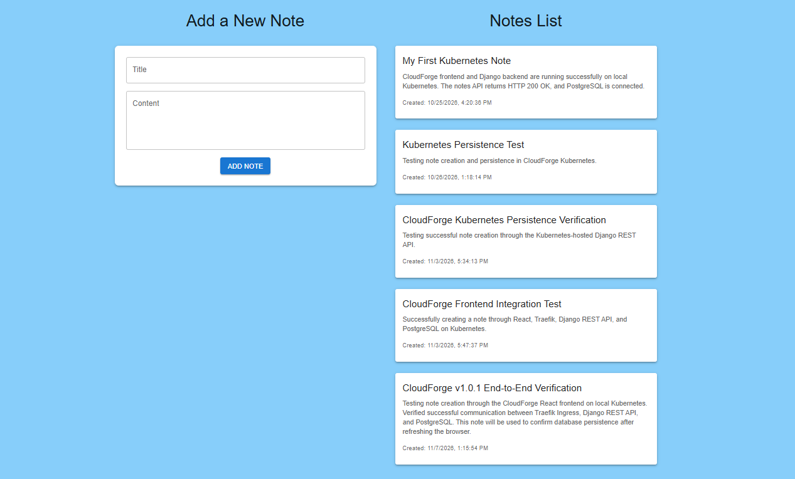
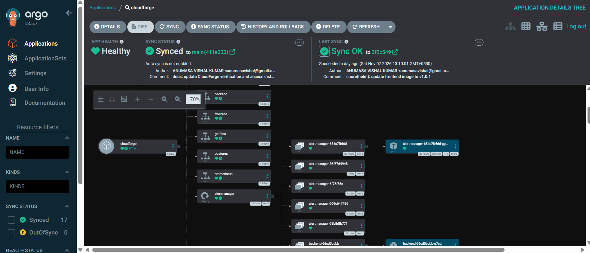
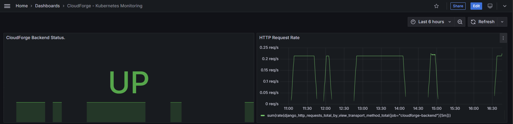
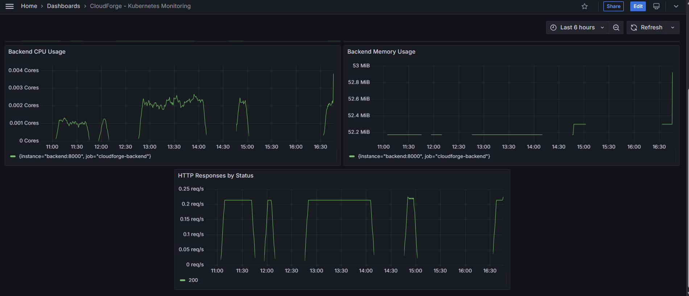
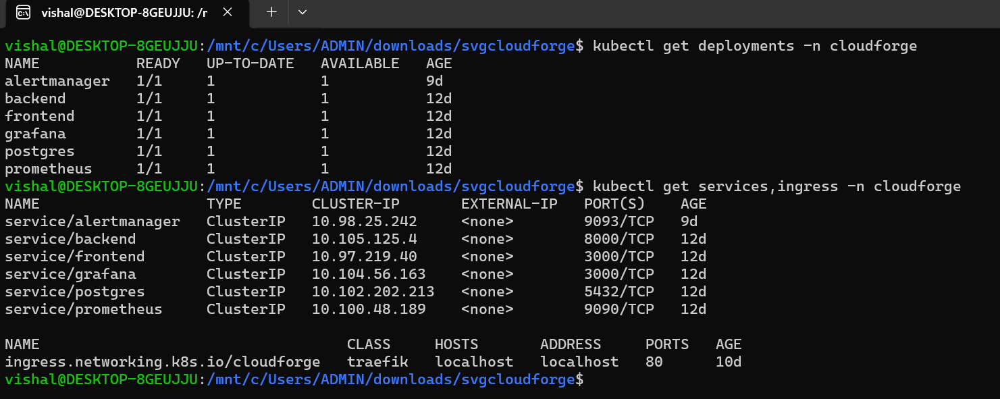
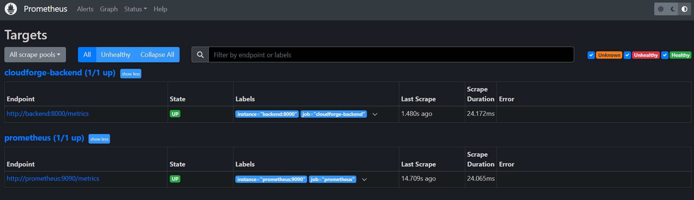
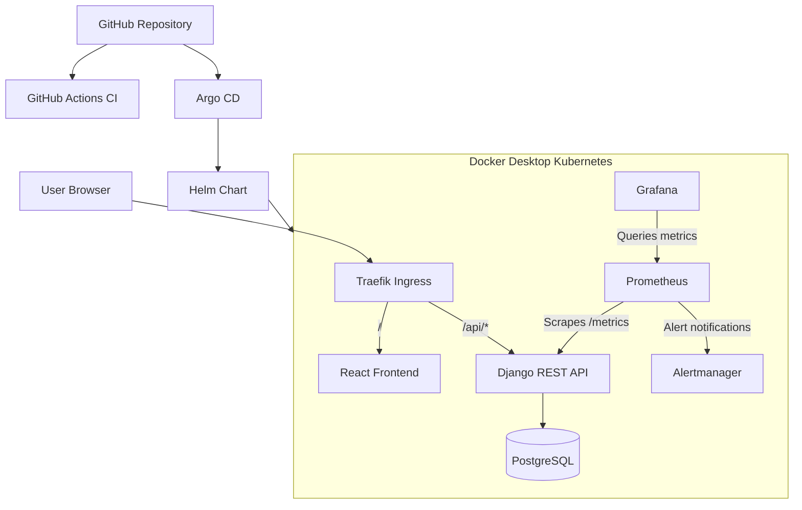

# CloudForge — Cloud-Native Application & DevOps Project

CloudForge is a containerized full-stack application deployed on local Kubernetes using Docker Desktop, Helm and Argo CD. The project has a formal **v1.0.0 release** and a subsequent **v1.0.1 frontend image iteration**.

The project demonstrates application development, containerization, Kubernetes orchestration, GitOps-based deployments, CI/CD automation, monitoring, persistent storage and container security hardening.

The application consists of a React frontend, Django REST API and PostgreSQL database, supported by Prometheus, Grafana and Alertmanager.

| Item | Status |
|---|---|
| Current deployment | Local Docker Desktop Kubernetes |
| Latest formal release | v1.0.0 |
| Current frontend image | v1.0.1 |
| Backend image | v1.0.0 |
| Latest formal Git tag | v1.0.0 |
| AWS deployment | Previously verified; currently offline |

The v1.0.1 frontend update is not a separate formal GitHub release or Git tag.


## Screenshots

### CloudForge application


### Argo CD GitOps dashboard


### Grafana application health


### Grafana backend performance


### Kubernetes workloads


### Prometheus targets


---

## Table of Contents

- [Screenshots](#screenshots)

1. [Architecture](#architecture)
2. [Technology Stack](#technology-stack)
3. [Application Features](#application-features)
4. [Repository Structure](#repository-structure)
5. [Run Locally with Docker Compose](#run-locally-with-docker-compose)
6. [Kubernetes Deployment](#kubernetes-deployment)
7. [Helm and Argo CD GitOps](#helm-and-argo-cd-gitops)
8. [Monitoring and Alerting](#monitoring-and-alerting)
9. [Container Security](#container-security)
10. [CI/CD Pipeline](#cicd-pipeline)
11. [Release Management](#release-management)
12. [Verification Results](#verification-results)
13. [Rollback Strategy](#rollback-strategy)
14. [Historical AWS Deployment](#historical-aws-deployment)
15. [Terraform and Infrastructure Management](#terraform-and-infrastructure-management)
16. [Security and Operational Notes](#security-and-operational-notes)
17. [Current Scope and Limitations](#current-scope-and-limitations)
18. [Author](#author)

---

## Architecture

### Current local Kubernetes architecture



### Application request flow

1. A browser accesses CloudForge through the local Traefik Ingress.
2. Requests to `/` are forwarded to the React frontend.
3. Requests to `/api/` are forwarded to the Django REST API.
4. Django communicates with PostgreSQL for application data.
5. Prometheus scrapes backend metrics from `/metrics`.
6. Grafana uses Prometheus as its metrics datasource.
7. Prometheus forwards configured alerts to Alertmanager.

### GitOps deployment flow

1. Code and Kubernetes configuration are maintained in GitHub.
2. GitHub Actions runs backend checks and frontend builds.
3. Argo CD monitors the GitHub repository.
4. Argo CD renders the Helm chart.
5. Changes are deployed through manual Argo CD synchronization.

The CloudForge Argo CD application uses manual synchronization rather than automatic deployment.

---

## Technology Stack

| Area | Technologies |
|---|---|
| Frontend | React, Node.js |
| Backend | Python 3.12, Django, Django REST Framework |
| Application server | Gunicorn |
| Database | PostgreSQL 16 |
| Containerization | Docker, Docker Compose |
| Orchestration | Kubernetes (Docker Desktop) |
| Package management | Helm |
| GitOps | Argo CD |
| Ingress | Traefik |
| Monitoring | Prometheus |
| Dashboards | Grafana |
| Alert management | Alertmanager |
| CI/CD | GitHub Actions |
| Infrastructure as Code | Terraform |
| Cloud infrastructure | AWS ECS, Fargate, ECR, RDS, ALB |

---

## Application Features

- React-based frontend for managing notes.
- Django REST API for retrieving and creating notes.
- PostgreSQL database persistence.
- Docker-based frontend and backend images.
- Kubernetes Deployments, Services and Ingress.
- PostgreSQL and Grafana persistent storage.
- Helm-based application configuration.
- Argo CD GitOps integration.
- GitHub Actions backend and frontend CI checks.
- Prometheus metrics collection and alert rules.
- Grafana monitoring dashboards.
- Alertmanager notification routing.
- Non-root backend and frontend containers.
- Kubernetes health and readiness checks.
- Versioned application images and Git release tags.

---

## Repository Structure

```text
cloudforge/
│
├── .github/
│   └── workflows/
│       └── ci.yml
│
├── app/
│   ├── backend/
│   │   ├── core/
│   │   ├── notes/
│   │   ├── requirements/
│   │   ├── Dockerfile
│   │   ├── entrypoint.sh
│   │   └── manage.py
│   │
│   └── frontend/
│       └── notes-frontend/
│           ├── Dockerfile
│           └── package.json
│
├── helm/
│   └── cloudforge/
│       ├── Chart.yaml
│       ├── values.yaml
│       └── templates/
│           ├── 01-database.yaml
│           ├── 02-backend.yaml
│           ├── 03-frontend.yaml
│           ├── 04-prometheus.yaml
│           ├── 05-grafana.yaml
│           ├── 06-prometheus-rules.yaml
│           ├── 07-alertmanager.yaml
│           ├── 08-ingress.yaml
│           └── _helpers.tpl
│
├── k8s/
│   ├── 01-database.yaml
│   ├── 02-backend.yaml
│   ├── 03-frontend.yaml
│   ├── 04-monitoring.yaml
│   ├── 05-grafana.yaml
│   ├── 06-ingress.yaml
│   ├── 07-prometheus-rules.yaml
│   └── 08-alertmanager.yaml
│
├── monitoring/
│   └── prometheus.yml
│
├── terraform/
│   ├── main.tf
│   └── .terraform.lock.hcl
│
├── .env.example
├── .gitignore
├── docker-compose.yml
└── README.md
```

The `helm/cloudforge/` directory is the primary Kubernetes deployment configuration used by Argo CD.

The `k8s/` directory contains the separate Kubernetes manifest-based configuration.

---

## Run Locally with Docker Compose

### Prerequisites

- Git
- Docker Desktop
- Docker Compose plugin
- Python 3.12 (optional for local development outside Docker)
- Node.js 18 (optional for frontend development outside Docker)

### 1. Clone the repository

```bash
git clone https://github.com/Vishalkumar0509/cloudforge.git
cd cloudforge
```

### 2. Configure environment variables

```bash
cp .env.example .env
```

Edit `.env` and configure the required local database and application settings.

Use local development credentials only. Never commit `.env` or production credentials.

### 3. Build and start the application

```bash
docker compose up --build -d
```

### 4. Verify containers

```bash
docker compose ps
```

### 5. Access the application

| Component | URL |
|---|---|
| React frontend | http://localhost:3000/ |
| Notes API | http://localhost:8000/api/notes/ |
| Backend health | http://localhost:8000/healthz/ |

These endpoints require the corresponding Docker Compose containers to be running.

### 6. Inspect logs

```bash
docker compose logs --tail=100
```

### 7. Stop the application

```bash
docker compose down
```

The normal `docker compose down` command retains named database volumes.

**Do not use `docker compose down -v` unless you deliberately intend to delete the database volume.**

---

## Kubernetes Deployment

CloudForge's current Kubernetes environment uses the Docker Desktop Kubernetes cluster. This is a local Kubernetes deployment, not Amazon EKS.

### Prerequisites

- Docker Desktop with Kubernetes enabled.
- `kubectl`
- Helm
- Argo CD installed in the cluster.
- Traefik Ingress Controller.
- Docker images available to the Kubernetes node.

### Application and monitoring components

The Kubernetes namespace is:

```text
cloudforge
```

The deployment includes:

| Component | Kubernetes resource |
|---|---|
| Backend | Deployment and Service |
| Frontend | Deployment and Service |
| PostgreSQL | Deployment, Service and PVC |
| Prometheus | Deployment, Service and ConfigMaps |
| Grafana | Deployment, Service and PVC |
| Alertmanager | Deployment, Service, ConfigMaps and PVC |
| Application routing | Traefik Ingress |

### Persistent storage

The local Kubernetes deployment uses persistent volume claims for stateful services:

| PVC | Component | Capacity | Access mode | Verification |
|---|---|---:|---|---|
| `postgres-data` | PostgreSQL | 2Gi | ReadWriteOnce | Bound |
| `prometheus-data` | Prometheus | 2Gi | ReadWriteOnce | Bound |
| `grafana-data` | Grafana | 2Gi | ReadWriteOnce | Bound |
| `alertmanager-data` | Alertmanager | 2Gi | ReadWriteOnce | Bound |

These claims use the local Docker Desktop Kubernetes storage provisioner. Local PVCs are not off-machine backups.

### Required Kubernetes Secrets

The application references locally created Kubernetes Secrets. Create these securely before deploying to a fresh cluster.

| Secret | Required keys |
|---|---|
| `cloudforge-db` | `POSTGRES_DB`, `POSTGRES_USERNAME`, `POSTGRES_PASSWORD` |
| `django-secret-key` | `DJANGO_SECRET_KEY` |
| `grafana-admin` | `admin-user`, `admin-password` |
| `grafana-smtp` | `username`, `password` |

Use secure credentials and an interactive creation process. Never commit Secret values or include them in application manifests.

If the Secrets already exist, do not overwrite them merely to repeat the deployment.

### Build local release images

For a fresh local environment, build the application images:

Backend:

```bash
docker build \
  -t cloudforge-backend:v1.0.0 \
  ./app/backend
```

Frontend:

```bash
docker build \
  --build-arg REACT_APP_API_URL= \
  -t cloudforge-frontend:v1.0.1 \
  ./app/frontend/notes-frontend
```

Verify the image tags:

```bash
docker image inspect cloudforge-backend:v1.0.0
docker image inspect cloudforge-frontend:v1.0.1
```

Ensure the Docker Desktop Kubernetes node can see both images before deploying. The Helm configuration uses `IfNotPresent`, which allows Kubernetes to use locally available images.

### Application access

The Traefik Ingress exposes the application at:

| Component | URL |
|---|---|
| Frontend | http://localhost/ |
| Notes API | http://localhost/api/notes/ |

The backend health endpoint is `/healthz/`. The current Ingress routes `/` to the frontend and `/api/` to the backend. Backend health and metrics can also be accessed through the backend Service port-forward documented in the Monitoring and Alerting section.

---

## Helm and Argo CD GitOps

CloudForge uses Helm for Kubernetes configuration and Argo CD for GitOps deployment.

### Helm chart structure

```text
helm/cloudforge/
├── Chart.yaml
├── values.yaml
└── templates/
    ├── 01-database.yaml
    ├── 02-backend.yaml
    ├── 03-frontend.yaml
    ├── 04-prometheus.yaml
    ├── 05-grafana.yaml
    ├── 06-prometheus-rules.yaml
    ├── 07-alertmanager.yaml
    ├── 08-ingress.yaml
    └── _helpers.tpl
```

### Release configuration

The Helm chart metadata in `Chart.yaml` remains at version 1.0.0 with appVersion 1.0.0:

```yaml
version: 1.0.0
appVersion: "1.0.0"
```

The current local application image configuration in `values.yaml` is:

```yaml
backend:
  image:
    repository: cloudforge-backend
    tag: v1.0.0
    pullPolicy: IfNotPresent

frontend:
  image:
    repository: cloudforge-frontend
    tag: v1.0.1
    pullPolicy: IfNotPresent
```

The frontend v1.0.1 image is a local iteration; it has not been published to ECR.

### Validate the Helm chart

```bash
helm lint ./helm/cloudforge
```

Render the Kubernetes resources:

```bash
helm template cloudforge ./helm/cloudforge \
  --namespace cloudforge
```

Package the release:

```bash
helm package ./helm/cloudforge
```

### Argo CD application configuration

The CloudForge Argo CD Application uses:

| Setting | Configuration |
|---|---|
| Application | `cloudforge` |
| Namespace | `argocd` |
| Repository | `Vishalkumar0509/cloudforge` |
| Branch | `main` |
| Helm path | `helm/cloudforge` |
| Helm release | `cloudforge` |
| Destination namespace | `cloudforge` |
| Sync policy | Manual |

Argo CD tracks the Helm chart in GitHub and compares the desired configuration with the running Kubernetes resources.

Useful commands:

```bash
kubectl get application cloudforge -n argocd
```

```bash
kubectl get deployments -n cloudforge
```

```bash
kubectl get pods -n cloudforge
```

```bash
kubectl get pvc -n cloudforge
```

For deployments, review the Argo CD diff before performing a manual sync.

### Access Argo CD locally

Start a local port-forward:

```bash
kubectl port-forward svc/argocd-server -n argocd 8080:443
```

Open the Argo CD interface at:

```text
https://localhost:8080
```

Keep the port-forward terminal open while using the interface. Stop it with `Ctrl+C`.

**Important:** Do not use direct `helm upgrade` or `kubectl apply` to modify application resources managed by Argo CD. Use the GitOps workflow so the Git repository remains the source of truth.

---

## Monitoring and Alerting

CloudForge includes two separate monitoring environments:

1. Docker Compose monitoring for local development.
2. Kubernetes monitoring for the deployed CloudForge application.

### Kubernetes monitoring

| Component | Purpose |
|---|---|
| Prometheus | Metrics collection and alert rule evaluation |
| Grafana | Monitoring dashboards |
| Alertmanager | Alert routing and notifications |

Prometheus scrapes:

```text
backend:8000/metrics
```

Backend health endpoint:

```text
/healthz/
```

The monitoring stack includes the `CloudForge Kubernetes Monitoring` Grafana dashboard and the `CloudForgeBackendDown` Prometheus alert rule.

The backend-down rule evaluates `up{job="cloudforge-backend"} == 0` with a one-minute pending period and critical severity. Its expected state is inactive while the backend is healthy.

### Local Kubernetes port-forwards

Run each command in a separate terminal:

Backend:

```bash
kubectl port-forward -n cloudforge service/backend 18000:8000
```

Prometheus:

```bash
kubectl port-forward -n cloudforge service/prometheus 19090:9090
```

Grafana:

```bash
kubectl port-forward -n cloudforge service/grafana 13003:3000
```

Alertmanager:

```bash
kubectl port-forward -n cloudforge service/alertmanager 19093:9093
```

Access the services:

| Service | Local URL |
|---|---|
| Backend API | http://localhost:18000/api/notes/ |
| Backend health | http://localhost:18000/healthz/ |
| Backend metrics | http://localhost:18000/metrics |
| Prometheus | http://localhost:19090 |
| Grafana | http://localhost:13003 |
| Alertmanager | http://localhost:19093 |

Keep the port-forward terminal open while using the corresponding endpoint. Stop it with `Ctrl+C`.

### Monitoring verification

Prometheus readiness:

```bash
curl -sS http://localhost:19090/-/ready
```

Prometheus targets:

```bash
curl -sS http://localhost:19090/api/v1/targets
```

Grafana health:

```bash
curl -sS http://localhost:13003/api/health
```

Alertmanager readiness:

```bash
curl -sS http://localhost:19093/-/ready
```

### SMTP email notifications

Grafana and Alertmanager obtain SMTP credentials from the Kubernetes `grafana-smtp` Secret. The Secret contains `username` and `password` keys; credentials are not stored in the Helm values file or committed to Git.

Alertmanager generates its runtime configuration using the Secret-provided SMTP username and password. Its configuration supports resolved notifications as well as firing notifications.

A controlled Alertmanager test verified delivery of both a firing notification and its corresponding resolved notification by email. This was a controlled SMTP delivery test; it does not mean the actual backend-down alert rule was triggered.

### Docker Compose monitoring

The separate Docker Compose monitoring stack provides Prometheus and Grafana for local development.

Its historical local endpoints are:

| Service | URL |
|---|---|
| Grafana | http://localhost:3001 |
| Prometheus | http://localhost:9090 |
| Prometheus targets | http://localhost:9090/targets |
| Backend metrics | http://localhost:8000/metrics |

The Docker Compose monitoring environment is not the Kubernetes monitoring environment or an AWS-hosted service.

---

## Container Security

The CloudForge backend v1.0.0 and frontend v1.0.1 images were hardened and verified in local Kubernetes.

### Backend security

| Setting | Value |
|---|---|
| Image | `cloudforge-backend:v1.0.0` |
| User | `cloudforge` |
| UID/GID | `10001` |
| Non-root enforcement | Enabled |
| Seccomp | `RuntimeDefault` |
| Privilege escalation | Disabled |
| Linux capabilities | All dropped |

### Frontend security

| Setting | Value |
|---|---|
| Image | `cloudforge-frontend:v1.0.1` |
| User | `node` |
| UID/GID | `1000` |
| Non-root enforcement | Enabled |
| Seccomp | `RuntimeDefault` |
| Privilege escalation | Disabled |
| Linux capabilities | All dropped |

The settings are applied through Kubernetes pod-level and container-level security contexts.

### Verification commands

Inspect the backend:

```bash
kubectl get deployment backend -n cloudforge -o yaml
```

Inspect the frontend:

```bash
kubectl get deployment frontend -n cloudforge -o yaml
```

Check the running backend identity:

```bash
kubectl exec -n cloudforge deployment/backend -- id
```

Check the running frontend identity:

```bash
kubectl exec -n cloudforge deployment/frontend -- id
```

These security settings apply to the hardened application containers. They should not be interpreted as a claim that every container in the project uses identical security settings.

---

## CI/CD Pipeline

Workflow file:

```text
.github/workflows/ci.yml
```

The GitHub Actions workflow runs on pushes and pull requests targeting `main`.

### CI jobs

**1. Backend Checks**

- Sets up Python 3.12.
- Installs backend requirements.
- Runs Django system checks.
- Runs the notes application tests.
- Uses PostgreSQL 16 as a test service.

**2. Frontend Build**

- Sets up Node.js 18.
- Installs dependencies using `npm ci`.
- Builds the React application.

**3. AWS publishing and deployment job**

The AWS job is conditional:

```yaml
if: github.event_name == 'push' &&
    github.ref == 'refs/heads/main' &&
    vars.ENABLE_AWS_DEPLOY == 'true'
```

When explicitly enabled, this job:

- Obtains AWS credentials using GitHub Actions OIDC.
- Authenticates with Amazon ECR.
- Builds and pushes backend and frontend images.
- Updates the ECS backend and frontend services.
- Waits for the ECS services to stabilize.

When `ENABLE_AWS_DEPLOY` is unset or not equal to `true`, the AWS job is skipped.

**Keep this variable disabled for local-only development and deployment.** Enabling it can trigger AWS publishing and ECS deployments.

### v1.0.0 release CI run

Release commit:

```text
a8195a94eab232626809756a7532747ef7d52672
```

Workflow run:

```text
42182510547
```

| Job | Result |
|---|---|
| Backend Checks | Success |
| Frontend Build | Success |
| Build and Push Docker Images to ECR | Skipped |

Latest follow-up CI run on November 8, 2026:

- Commit: `8e83acb`
- Workflow run: `42461034073`
- Result: Successful

GitHub Actions CLI commands:

```bash
gh run list --repo Vishalkumar0509/cloudforge --branch main --limit 5
```

Inspect an individual run:

```bash
gh run view RUN_ID --repo Vishalkumar0509/cloudforge
```

---

## Release Management

CloudForge v1.0.0 is the first stable tagged release.

### Release metadata

| Item | Value |
|---|---|
| Application version | `1.0.0` |
| Helm chart version | `1.0.0` |
| Docker backend tag | `v1.0.0` |
| Docker frontend tag at formal release | `v1.0.0` |
| Current frontend image iteration | `v1.0.1` |
| Git tag | `v1.0.0` |
| Release commit | `a8195a94eab232626809756a7532747ef7d52672` |

### Versioned images

```text
cloudforge-backend:v1.0.0
cloudforge-frontend:v1.0.1
```

The formal v1.0.0 backend and frontend tags were created from the already-tested security-hardened images without rebuilding them. The frontend was subsequently updated to the local v1.0.1 image iteration.

The current backend v1.0.0 and frontend v1.0.1 images were verified on the local Docker Desktop Kubernetes node. They have not been published to ECR.

### Release tag verification

```bash
git show v1.0.0
```

```bash
git ls-remote --tags origin 'refs/tags/v1.0.0*'
```

The annotated Git tag is published to GitHub. A separate GitHub Release page and published container registry artifacts are separate distribution steps.

---

## Verification Results

The following results were verified during the CloudForge v1.0.0 local Kubernetes release process on November 6, 2026. Additional frontend, monitoring and SMTP verification was completed on November 7, 2026.

### Kubernetes workload status

All six Deployments were verified with one ready replica:

| Deployment | Result |
|---|---|
| Backend | 1/1 Ready |
| Frontend | 1/1 Ready |
| PostgreSQL | 1/1 Ready |
| Prometheus | 1/1 Ready |
| Grafana | 1/1 Ready |
| Alertmanager | 1/1 Ready |

### Application verification

- React frontend returned HTTP 200 through Traefik.
- Django Notes API returned HTTP 200.
- Four existing notes were returned by the API.
- Backend `/healthz/` endpoint returned HTTP 200.
- Backend successfully connected to PostgreSQL.
- Django reported no pending migrations.
- Existing PostgreSQL records remained accessible after the backend image rollout.

### November 7 follow-up verification

- Frontend Deployment updated to the local `cloudforge-frontend:v1.0.1` image and reached 1/1 ready.
- Frontend Ingress and Notes API Ingress both returned HTTP 200.
- The Notes application displayed five notes during browser verification.
- Prometheus reported both configured scrape targets UP (2/2).
- The `CloudForgeBackendDown` rule was loaded and healthy; it remained inactive while the backend was up.
- Grafana dashboard included backend status, HTTP request rate, response status, memory and CPU panels.
- Alertmanager accepted a controlled test alert, and both firing and resolved notification emails were received.

**GitOps status:** On November 8, 2026, the SMTP-related Helm template and values changes were committed and pushed in commit `8e83acb` (`fix(monitoring): secure SMTP configuration and document alerts`). Argo CD subsequently reported `Synced` and `Healthy` at revision `8e83acbd59dc881b91e05555b11ddb2dd1b4233c`. At the time of this GitOps verification, the local Git branch matched `origin/main` and the working tree was clean. This README documentation update is a subsequent, separate change.

### November 8 follow-up verification

The following checks were completed against the current local Kubernetes deployment:

- Frontend Ingress returned HTTP 200.
- Notes API Ingress returned HTTP 200.
- All six application and monitoring Deployments were verified with one ready replica each.
- Prometheus reported both active scrape targets as UP (2/2): `cloudforge-backend` and `prometheus`.
- Grafana health API reported database `ok` on version `11.4.0`.
- Alertmanager readiness endpoint returned HTTP 200 and `OK`.
- The `CloudForgeBackendDown` rule was loaded with health `ok`, state `inactive`, and a 60-second pending period.
- Argo CD reported `Synced` and `Healthy` at the latest Git commit.
- Git working tree was clean after removal of an accidental empty untracked file.

The inactive backend-down rule is expected while the backend target is healthy. The actual backend-down condition was not deliberately triggered during this verification.

### November 10 follow-up: persistence and runtime incident

- Alertmanager persistent storage was added to the Helm chart and committed in `0377ec4` (`feat: add persistent storage for Alertmanager`).
- Argo CD reported `Synced` and `Healthy` at revision `0377ec4cdb4fbfa635cc9ad975054ef51fc3c9b5`.
- All four application and monitoring PVCs (`postgres-data`, `prometheus-data`, `grafana-data` and `alertmanager-data`) were Bound at 2Gi with ReadWriteOnce access.
- Alertmanager's `/-/ready` endpoint returned `OK`; its Deployment had one available replica.
- All six application and monitoring Deployments were running with one ready replica each.

**Runtime incident:** On November 10, 2026, at approximately 05:52 UTC, all nine observed Kubernetes system containers and multiple CloudForge application containers terminated with `Error` and exit code `255` within the same one-second interval. The Kubernetes node subsequently reported Ready, with MemoryPressure, DiskPressure and PIDPressure all False. The WSL2 Ubuntu and Docker Desktop distributions were both running during follow-up checks.

The simultaneous termination pattern strongly suggests a shared Docker Desktop/WSL2 Kubernetes runtime interruption rather than independent application failures. The exact trigger was not established. The workloads were healthy again during verification; no manual restart was performed solely to clear historical restart counts.

### November 10 final reliability verification

- Added Kubernetes liveness probes for PostgreSQL (`pg_isready`), Grafana (`/api/health`) and Alertmanager (`/-/ready`) in commit `2353b2e` (`feat: add liveness probes for stateful services`).
- Helm validation completed successfully: `helm lint helm/cloudforge` reported zero chart failures, and Helm template rendering succeeded.
- Argo CD reported `Synced` and `Healthy` at revision `2353b2e7091d6d64be497f7d6c12f36eacc7a4c4`.
- All six CloudForge Deployments had one available replica, and all six CloudForge pods were Ready. All four 2Gi ReadWriteOnce PVCs remained Bound.
- PostgreSQL persistence was tested through the application API. A temporary test note was created, verified through the API and directly in PostgreSQL, and remained present after a PostgreSQL Deployment restart. The API returned HTTP 200 after the restart. The temporary test record was then removed; the five pre-existing notes remained.
- A PostgreSQL custom-format backup archive was created and its table of contents was successfully inspected with `pg_restore --list` (86 entries). A full restore into a separate database has not yet been tested.
- GitHub Actions CI passed for commit `2353b2e` (run `42832329810`, approximately 40 seconds).

These checks validate the local Docker Desktop Kubernetes environment. They do not establish production readiness, an off-machine backup, or a tested database recovery procedure. The AWS deployment remains offline.

### Security verification

- Backend actual runtime identity: UID/GID 10001.
- Frontend actual runtime identity: UID/GID 1000.
- Both application containers ran as non-root.
- RuntimeDefault seccomp was configured.
- Privilege escalation was disabled.
- All Linux capabilities were dropped.
- Both hardened image rollouts completed with zero restarts on their new pods.

### GitOps and monitoring verification

- At the November 10 final verification, Argo CD reported `Synced` and `Healthy` at revision `2353b2e7091d6d64be497f7d6c12f36eacc7a4c4`.
- Prometheus server readiness passed.
- Prometheus backend and self-monitoring targets reported `up`.
- Grafana health endpoint reported database `ok`.
- Alertmanager readiness endpoint returned `OK`.

These results describe the verified local release. They do not mean that the AWS deployment is currently online.

---

## Rollback Strategy

CloudForge uses Git and Argo CD as the source of truth for Kubernetes application configuration.

The known previous image tags from the v1.0.0 promotion are:

```text
cloudforge-backend:security-test
cloudforge-frontend:security-test
```

Those tags pointed to the same tested image contents as the corresponding v1.0.0 tags during this release.

### Recommended rollback approach

If a future application release causes problems:

1. Identify the last known-good image tags and Git commit.
2. Change the affected Helm image tag in `helm/cloudforge/values.yaml` to the verified previous image.
3. Increase the Helm chart version for the corrective release.
4. Run `helm lint` and `helm template`.
5. Commit and push the reviewed rollback configuration.
6. Review the Argo CD diff.
7. Manually sync the affected application Deployment.
8. Verify Kubernetes readiness, application health and database records.

Avoid using `kubectl rollout undo` as the permanent GitOps rollback method because Argo CD may reconcile the Deployment back to the configuration in Git.

**Rollback procedure status:** The previous image tags are available locally. A separate rollback exercise has not been documented as completed.

---

## Historical AWS Deployment

CloudForge was previously deployed in AWS region:

```text
ap-south-2
```

The historical architecture included:

- Amazon ECS with AWS Fargate.
- Amazon ECR repositories.
- Application Load Balancer.
- Amazon RDS for PostgreSQL.
- VPC, subnets and security groups.
- Terraform-managed infrastructure.
- GitHub Actions OIDC authentication.

The AWS application deployment has since been taken offline for cost control.

The last documented state recorded the following actions:

- Application Load Balancer deleted.
- ECS services scaled to zero.
- RDS instance stopped.

There is no currently verified public AWS application endpoint.

AWS should be considered a separate future deployment milestone. Before reactivating it, review infrastructure status, Terraform state, IAM permissions, image publishing and estimated costs.

---

## Terraform and Infrastructure Management

The Terraform configuration is maintained under:

```text
terraform/
```

The configuration describes historical AWS infrastructure, including networking, security groups, ECS services, ECR repositories, an Application Load Balancer and RDS PostgreSQL.

### Terraform validation

From the repository root:

```bash
cd terraform
terraform init
terraform validate
```

Inspect the working state before any plan:

```bash
terraform state list
```

A fresh Git clone does not contain the local Terraform state. Without the correct state, Terraform may propose creating or replacing infrastructure.

**Never apply a Terraform plan without confirming the correct state and reviewing every proposed action.**

Terraform state files, backup files, `.terraform/` and production variable files are excluded from Git.

Never commit state files, credentials or production secrets.

---

## Security and Operational Notes

- Never commit `.env` files or Kubernetes Secret values.
- Keep Django secret keys and PostgreSQL credentials out of Git.
- Protect Terraform state and backup files.
- Use IAM least privilege for AWS operations.
- Keep the AWS publishing/deployment workflow disabled during local-only work.
- The current local application is served over HTTP.
- Local Kubernetes PVC storage is not a substitute for off-machine database backups.
- Docker Desktop and its Kubernetes cluster must be running for the local deployment to remain available.
- Review image tags and Argo CD differences before deployment.
- Do not delete PostgreSQL or Grafana PVCs as part of ordinary troubleshooting.

---

## Current Scope and Limitations

The formal CloudForge v1.0.0 release and subsequent v1.0.1 frontend iteration demonstrate:

- Full-stack application development.
- Docker containerization.
- Kubernetes deployment and persistent storage.
- Helm chart management.
- Argo CD GitOps workflows.
- GitHub Actions CI.
- Prometheus, Grafana and Alertmanager monitoring.
- Container security hardening.
- Versioned image and release management.
- Historical AWS and Terraform infrastructure work.

The current verified deployment is local Kubernetes on Docker Desktop. AWS deployment is offline, and the versioned application images are available in the local image store rather than a published container registry.

---

## Author

**Vishal Kumar Anumasa**

- GitHub: https://github.com/Vishalkumar0509
- Project repository: https://github.com/Vishalkumar0509/cloudforge
